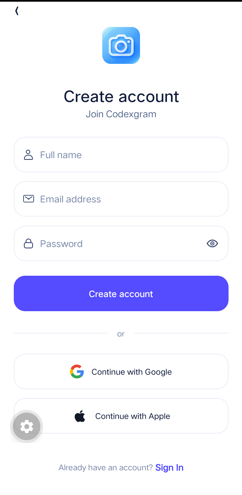
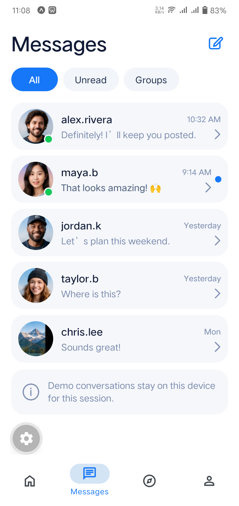
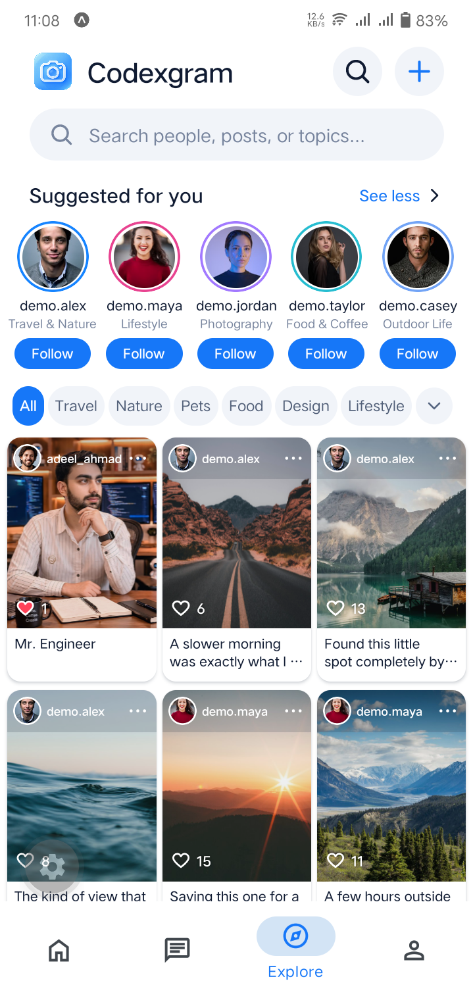
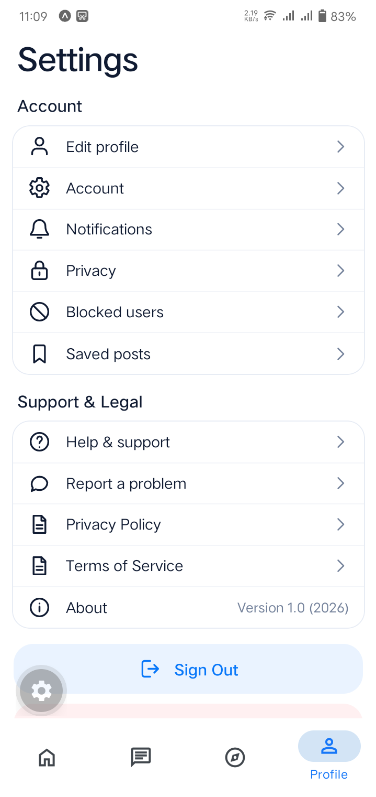

# Codexgram: Real-Time Type-Safe Mobile Ecosystem 🚀📱

Welcome to the official repository for **Codexgram**! This project is a state-of-the-art, production-grade cross-platform mobile application built using **React Native**, **Expo (Managed Workflow)**, and **TypeScript**. Codexgram integrates a high-performance **Convex Cloud Backend** to handle live database mutations, reactive subscriptions, and persistent file transactions instantly, eliminating traditional REST polling overhead.

---

## 📱 Interactive Interface Showroom

Experience the continuous user-journey flow of Codexgram from initial user authentication, social spaces onboarding, layout exploration, and final dynamic home feed publication:

### 🔒 Phase 1: Onboarding & Core Application Views

A step-by-step presentation of the system onboarding funnel, initial layout structures, messaging interfaces, and content discovery mechanics:

<table>
  <tr>
    <td align="center" width="25%">
      
      <br />
      <b>01. Auth Gateway</b>
      <p style="font-size: 11px; color: #666;">Secure account registration and credentials isolation using Clerk Auth workflows.</p>
    </td>
    <td align="center" width="25%">
      
      <br />
      <b>02. Initial Home Screen</b>
      <p style="font-size: 11px; color: #666;">Clean initial state layout prompt encouraging user engagement and initial tracking setup.</p>
    </td>
    <td align="center" width="25%">
      
      <br />
      <b>03. Instant Messages</b>
      <p style="font-size: 11px; color: #666;">Bidirectional persistent WebSocket message streams with near-zero transmission latency.</p>
    </td>
    <td align="center" width="25%">
      
      <br />
      <b>04. Explore Feed</b>
      <p style="font-size: 11px; color: #666;">High-performance reactive grid layout tracking cloud assets across the ecosystem.</p>
    </td>
  </tr>
</table>

### 🛠️ Phase 2: Profile Settings & Dynamic Social Engagements

Reviewing system settings customization capabilities, content personalization arrays, and the finalized dynamic user timeline after syncing user dependencies:

<table>
  <tr>
    <td align="center" width="33%">
      
      <br />
      <b>05. Profile Dashboard</b>
      <p style="font-size: 11px; color: #666;">Type-safe view compiling user metrics, stored post tracking arrays, and clean glassmorphism styling parameters.</p>
    </td>
    <td align="center" width="33%">
      
      <br />
      <b>06. Preferences & Settings</b>
      <p style="font-size: 11px; color: #666;">Granular configuration layout tracking system state variables, cache rules, and account deletion gates.</p>
    </td>
    <td align="center" width="33%">
      
      <br />
      <b>07. Live Active Home Feed</b>
      <p style="font-size: 11px; color: #666;">The final state realization after matching community records, uploading rich media blobs via the asset pipeline, and processing reactive mutations.</p>
    </td>
  </tr>
</table>

---

## 📂 Architecture & Project Directory Map

The codebase follows a highly structured, scalable layout designed for enterprise asset deployment:

```text
Codexgram/
├── .expo/                # Local Expo dev compilation caches
├── android/              # Native Android build wrapper (generated during prebuild)
├── assets/               # System-wide typography vector files, icons, splash layouts
├── convex/               # Convex Backend Cloud Logic (Real-time functions & Schemas)
├── design/               # High-fidelity visual mockups and profile screenshots
├── dist/                 # Static web/assets redistribution output container
├── legal/                # Compliance docs, terms of service, privacy parameters
├── node_modules/         # System dependency package allocations
├── src/                  # Central Type-Safe Application Codebase
│   ├── app/              # File-based navigation structure (Expo Router mapping)
│   ├── components/       # Reusable layout UI blocks (Video players, feed views)
│   └── constants/        # System global tokens and modular styling values
├── app.json              # Central Expo config mapping, bundles, and metadata
├── eas.json              # Expo Application Services configuration profiles
├── eslint.config.js      # System code syntax rules configuration layout
└── package.json          # Dependency control board and compilation scripts
```

---

## 🛠️ Comprehensive Tech Stack & Architectural Matrix

### 📱 Client-Side Engineering (Mobile Interface)

- **Core Application Engine:** **React Native via Expo** for rapid cross-platform runtime performance across iOS and Android.
- **Navigation Framework:** `expo-router` for type-safe, file-based modular screen path links.
- **Identity Management:** **Clerk Authentication** processing secure social entries, multi-factor logins, and biometric validation loops.
- **Visual Layer UX:** Embedded `expo-glass-effect` alongside custom `react-native-svg` layouts to craft premium glassmorphism interfaces and fluid animations.
- **Advanced Media Engine:** `expo-video` and `expo-image` pipelines processing lightning-fast local cache queries for immediate rich-media rendering.
- **Telemetry Diagnostics:** **Sentry Integration** (`@sentry/react-native`) providing live, real-time error reporting and stack trace tracking directly from remote testing devices.

### ⚙️ Cloud Engine Infrastructure (Convex Backend)

- **Database & File Store Architecture:** **Convex** cloud infrastructure providing reactive database schemas and serverless functions that stream database updates directly to the client UI via WebSockets.
- **Type-Safety Strategy:** End-to-end TypeScript configurations map the shape of Convex mutations and queries all the way to frontend view components.

---

## 🏃‍♂️ Local Installation and Setup

Ensure you have Node.js v20+ and the Expo Go app installed on your testing device before beginning:

### 1. Clone the Repository

```bash
git clone https://github.com
cd Codexgram
```

### 2. Install Project Dependency Modules

```bash
npm install
```

### 3. Establish and Link Your Convex Environment

Execute the Convex setup command to initialize a new free developer cluster sandbox up in the cloud:

```bash
npx convex dev
```

_This command will automatically link your terminal workspace to a Convex cluster account and generate your private `.env.local` connection strings securely._

### 4. Configure Your Clerk Keys

Open your newly created local `.env` and fill out your environment signatures:

```env
EXPO_PUBLIC_CLERK_PUBLISHABLE_KEY="pk_test_your_clerk_public_key_here"
```

<h3>5. Fire Up the Metro Bundler</h3>
Start the development network instance to compile your TypeScript components:

```bash
npx expo start
```

_Press `a` to load onto an open Android Emulator, `i` to map directly to an iOS Simulator, or scan the QR code via your smartphone's **Expo Go** application layer to interact with the system live!_

---

## 🛡️ Applied Mobile Engineering Standards

- **Reactive Real-Time Subscriptions:** Leverages Convex hooks (`useQuery`) to establish active WebSocket tunnels, updating the interface instantly as database states change.
- **Type-Safe Component Pipelines:** TypeScript prevents contract mismatches between backend data fields and presentation layers.
- **Robust Telemetry Safeguards:** Sentry crash capturing isolates edge cases and anomalies before builds exit staging phases.

## 📄 License

This application ecosystem is open-source and available under the [MIT License](LICENSE).
